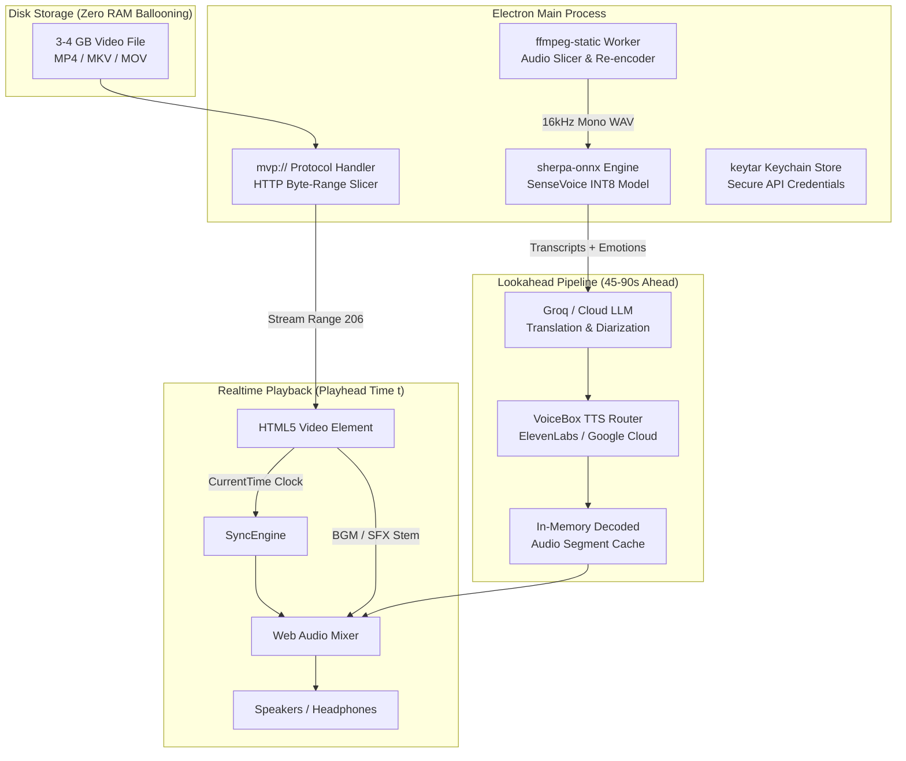

# 🎬 MaxEdge Video Player (MVP)

> **Next-Generation Desktop Media Player with Real-Time AI Dubbing, On-Device Multilingual ASR, Voice Cloning, and Large-File Streaming.**

[](https://www.electronjs.org/)
[](https://react.dev/)
[](https://vitejs.dev/)
[](https://redux-toolkit.js.org/)
[](https://github.com/k2-fsa/sherpa-onnx)
[](https://ffmpeg.org/)
[](LICENSE)

---

## 🌟 Overview

**MaxEdge Video Player** is a cinematic desktop video player engineered from the ground up to solve the hardest challenges in modern video consumption and AI-powered dubbing:

1. **Massive Video Handling (3–4 GB+)**: Stream multi-gigabyte 4K and 1080p video files instantly with random seeking in under 500ms and zero full-file memory consumption.
2. **Real-Time AI Dubbing & Translation**: Listen to foreign films, reels, and tutorials translated dynamically ahead of the playhead with zero stutter.
3. **On-Device SenseVoice ASR**: Sub-70ms on-device speech recognition via quantized INT8 ONNX models with integrated Speech Emotion Recognition (SER) and Audio Event Detection (AED).
4. **Cinematic Immersion & Stem Protection**: Center-vocal cancellation and intelligent soundtrack ducking that preserve Hans Zimmer orchestral scores, gunshots, explosions, and room foley without dialogue bleed.
5. **Instant Voice Cloning**: Extract the actor's vocal sample directly from the playback timeline to synthesize speech in their original vocal timbre.
6. **Multi-Engine VoiceBox & Cost Optimizer**: Unified TTS engine layer supporting ElevenLabs and Google Cloud TTS with automatic cost-per-million character estimation, failover, and session spending limits.

---

## ⚡ Core Features

### 🚀 Zero-Memory Large File Streaming (`mvp://`)
- Built with a custom privileged Electron protocol (`mvp://local/...`) that serves media directly from disk using HTTP partial byte-range requests (`Range: bytes=start-end`).
- Flat, minimal memory footprint regardless of file size (tested on 4 GB+ high-bitrate `.mp4`, `.mkv`, `.webm`, `.mov`).
- Instant timeline scrubbing and seek response (<500 ms to first decoded frame).

### 🎙️ On-Device SenseVoice Multilingual ASR
- Runs locally via `sherpa-onnx` and `onnxruntime` with an INT8 quantized SenseVoice-Small model (~140 MB).
- **Sub-70ms inference latency** on Apple Silicon (M-series) and ~120ms on modern x86_64 CPUs.
- **Speech Emotion Recognition (SER)**: Tags delivery (`<|HAPPY|>`, `<|ANGRY|>`, `<|SAD|>`) to dynamically modulate TTS prosody and style.
- **Audio Event Detection (AED)**: Detects natural laughter (`<|LAUGHTER|>`), crying (`<|CRYING|>`), and sighs, bypassing AI dubbing to keep the human performance intact.
- In-app 1-click model download with automatic integrity checks.

### 🎭 Cinematic Dubbing & Stem Separation
- **Center-Vocal Eliminator**: Out-of-phase stereo cancellation node targeting dialogue center pans (300 Hz – 3400 Hz) while passing stereo soundtrack and effects.
- **Intelligent Sidechain Ducking**: Smooth volume ramps during speech intervals to prevent speech clash while retaining full background music (BGM).
- **Dynamic WSOLA Time-Stretching**: Matches translated dialogue length to the actor’s original speech boundary without pitch alteration.

### 🧬 Instant Voice Cloning & Speaker Diarization
- One-click voice sampling: captures clear dialogue segments from the media and registers cloned voice personas with ElevenLabs.
- Contextual multi-speaker tracking with fundamental pitch ($F_0$) profiling to route male, female, and secondary roles to distinct voice presets.

### 💰 Cost-Aware VoiceBox TTS Pipeline
- Unified adapter abstraction over **ElevenLabs** and **Google Cloud TTS**.
- **Real-Time Cost Estimator**: Calculates $/1M character costs across target languages and routes queries to the cheapest enabled provider by default.
- **Transparent Failover**: Automatically cascades to secondary engines if rate limits, authentication issues, or network errors occur.
- **Look-Ahead Prefetching**: Predictively generates upcoming speech segments into an in-memory segment cache 45–90s ahead of playback.

### 🎛️ Dual-Sync Architecture & FFmpeg Re-Encoding
- **Live Sync Mode (Default)**: Plays dual audio tracks (video audio + Web Audio TTS stream) with real-time drift correction (<30 ms error threshold).
- **Offline Stream-Copy Re-Encoding**: Merges synthesized audio directly into the video container using bundled `ffmpeg-static` without re-compressing the video track.

---

## 🏗️ Architecture



---

## 📂 Project Structure

```
maxvideoplayer/
├── .gitignore                   # Optimized rules for Electron, build targets & caches
├── README.md                    # Project documentation
├── docs/                        # Specifications and design contracts
│   ├── PRD.md                                          # Product Requirements Document
│   ├── TECHNICAL_SPECIFICATION.md                      # Complete system specification
│   ├── SENSEVOICE_LOCAL_INTEGRATION_SPEC.md            # On-device ASR and emotion tagging
│   ├── CINEMATIC_AI_DUBBING_AND_STEM_SEPARATION_SPEC.md# Diarization and stem ducking
│   └── META_REELS_AI_DUBBING_SPEC.md                   # Short-form video translation spec
└── electron/                    # Application source code
    ├── package.json             # App dependencies and build scripts
    ├── vite.config.js           # Vite configuration for React renderer
    ├── index.html               # Web view entrypoint
    ├── main.js                  # Electron main process (IPC, protocols, keychain)
    ├── preload.js               # Context bridge (secure renderer API)
    └── src/
        ├── App.jsx              # Application layout and overlays
        ├── main.jsx             # React DOM root
        ├── store.js             # Redux Toolkit store (video, audio, engines, sync)
        ├── styles.css           # Premium dark-mode design system
        ├── components/
        │   ├── Player.jsx       # Video viewport, transport bar & live dubber
        │   ├── Settings.jsx     # API keys, ASR model manager & engine picker
        │   └── VoicePicker.jsx  # Voice selection and preview modal
        └── services/
            ├── languageDetector.js  # Heuristic and metadata language detection
            ├── transcript.js        # SRT/VTT parser & segment generator
            ├── ttsPrefetcher.js     # Lookahead audio synthesis buffer
            ├── syncEngine.js        # Microsecond A/V sync & drift correction
            ├── liveDubber.js        # Continuous subtitle & dubbing manager
            ├── stemSeparator.js     # Center vocal elimination & ducking filters
            ├── voiceCloner.js       # ElevenLabs voice clone synthesizer
            ├── speakerRegistry.js   # Character persona and voice mapping
            ├── localModelManager.js # SenseVoice model download & IPC bridge
            └── voicebox/
                ├── index.js         # VoiceBox router, selection & failover
                ├── elevenlabs.js    # ElevenLabs TTS adapter
                ├── google.js        # Google Cloud TTS adapter
                └── costEstimator.js # Engine price estimation ($/1M chars)
```

---

## 🚀 Getting Started

### Prerequisites

- **Node.js**: v18.0.0 or higher (v20+ recommended)
- **npm** or **yarn**
- **Operating System**: macOS (Intel / Apple Silicon), Windows 10/11, or Linux

> **Note on Native Dependencies**: This project uses `keytar` for OS Keychain storage and `ffmpeg-static` for audio slicing. On Linux, ensure `libsecret-1-dev` is installed:
> ```bash
> sudo apt-get install -y libsecret-1-dev
> ```

### Installation

1. **Clone the repository:**
   ```bash
   git clone https://github.com/your-username/maxvideoplayer.git
   cd maxvideoplayer/electron
   ```

2. **Install dependencies:**
   ```bash
   npm install
   ```

3. **Start the application in development mode:**
   ```bash
   npm run dev
   ```
   *This starts the Vite dev server on port `5173` and boots Electron automatically.*

---

## ⚙️ Configuration & API Keys

All sensitive credentials are saved securely in your **OS Keychain** via `keytar` (with fallback to an obfuscated local store):

| Service | Setting | Description |
| :--- | :--- | :--- |
| **ElevenLabs** | API Key | Ultra-realistic expressive TTS and instant voice cloning |
| **Google Cloud TTS** | API Key | Low-cost neural voices across 50+ languages |
| **Groq / Cloud LLM** | API Key | Fast subtitle translation and contextual diarization |
| **SenseVoice ASR** | Local Download | Quantized INT8 model downloaded directly inside **Settings** (Zero API key needed) |

To configure keys:
1. Launch the app and click the **Settings (⚙️)** icon in the top header.
2. Enter your API credentials in the respective fields.
3. In the **Speech Recognition (ASR)** tab, click **Download SenseVoice Model** to fetch the on-device transcription weights (~140 MB).
4. Select your **Target Language** for automatic translation.

---

## 🎮 Usage Guide

### Playing Media Files
- Drag and drop any video file into the window, or click **Open File**.
- Supported formats: `.mp4`, `.mkv`, `.webm`, `.mov`, `.avi`, `.m4v`, `.ogv`.
- Scrub through multi-gigabyte files freely using the timeline seek bar.

### Enabling Live AI Dubbing
- Toggle the **AI Dubbing** switch on the player controls.
- Choose your **Target Language** from the dropdown menu.
- The player will look ahead on the video audio, generate transcripts via SenseVoice or Whisper, translate lines, prefetch TTS audio, and mix it over the ducked background soundtrack in real time.

### Cloning an Actor's Voice
- While playing a video with clear dialogue, click the **Clone Voice** button.
- The player extracts a 10-second vocal reference, registers it with ElevenLabs, and sets the newly created voice as the active synthesis voice.

### Exporting (Offline Re-Encoding)
- If you prefer a permanent standalone file rather than live playback, toggle the mode to **Re-Encode**.
- Click **Export Video** to run an FFmpeg stream-copy process that merges the generated audio track into a new `.mp4` file.

---

## 🛠️ Build & Packaging

To compile production bundles and desktop installers for your operating system:

```bash
# Build the React production bundle via Vite
npm run build

# Package desktop executables (DMG, NSIS, or AppImage)
npm run package
```

The output installers will be generated under `electron/dist/` or `electron/release/`:
- **macOS**: `dmg` (Intel / Apple Silicon universal binary)
- **Windows**: `nsis` (`.exe` installer)
- **Linux**: `AppImage`

---

## 📚 Technical Documentation

For in-depth architectural blueprints, review the design documents in `/docs`:
- [Product Requirements Document (PRD)](docs/PRD.md)
- [Technical Specification & Implementation Architecture](docs/TECHNICAL_SPECIFICATION.md)
- [SenseVoice On-Device ASR Integration Specification](docs/SENSEVOICE_LOCAL_INTEGRATION_SPEC.md)
- [Cinematic AI Dubbing & Stem Separation Specification](docs/CINEMATIC_AI_DUBBING_AND_STEM_SEPARATION_SPEC.md)
- [Short-Form Reels AI Dubbing Specification](docs/META_REELS_AI_DUBBING_SPEC.md)

---

## 🤝 Contributing

Contributions, bug reports, and feature requests are welcome!

1. Fork the repository
2. Create your feature branch (`git checkout -b feature/amazing-feature`)
3. Commit your changes (`git commit -m 'Add some amazing feature'`)
4. Push to the branch (`git push origin feature/amazing-feature`)
5. Open a Pull Request

---

## 📄 License

This project is licensed under the [MIT License](LICENSE).
