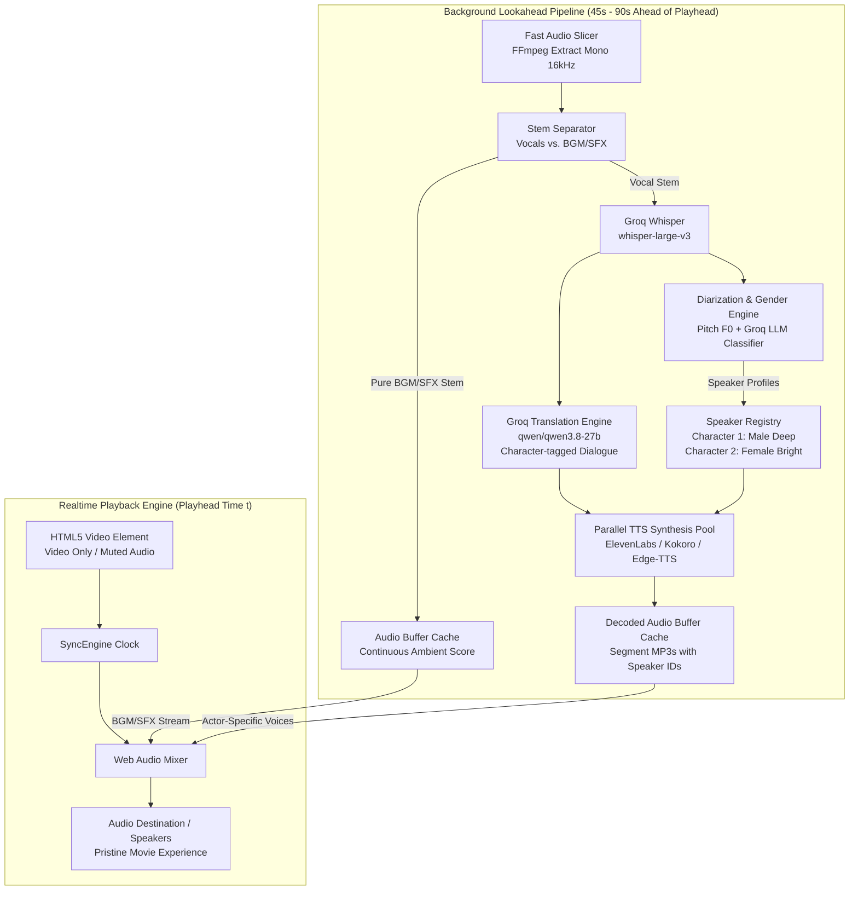
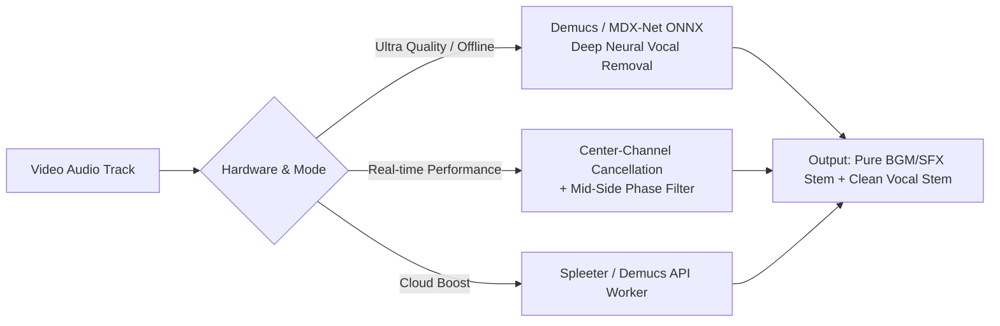
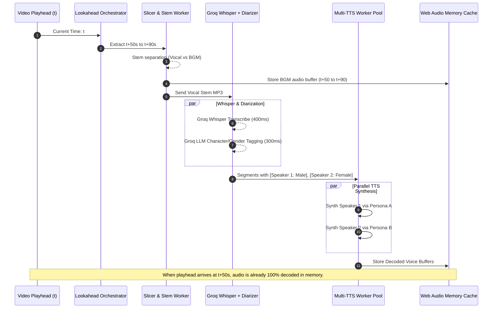

# Cinematic AI Dubbing & Stem Separation Architecture Specification
**Real-Time Multi-Speaker Diarization, Gender-Aware Voice Personas, and Pristine BGM/SFX Preservation**

---

## 1. Executive Summary & Problem Statement

In cinema, audio accounts for 50% of the emotional immersion. While basic AI dubbing translates words and plays back speech, standard single-voice TTS with simple soundtrack ducking ruins the cinematic movie experience in two critical ways:

1. **Gender & Character Timbre Monotony**: 
   - When a female co-star speaks right after a male protagonist, or when a child speaks in a thriller, playing all characters with a single voice clone or uniform voice breaks disbelief immediately.
   - Dialogue requires **Speaker Diarization & Gender/Persona Profiling**: the player must detect speaker turns, determine gender, age, and emotional timbre, and route each character to a distinct, matched voice persona in real time.

2. **Soundtrack Bleed vs. Soundtrack Murder (The Ducking Dilemma)**:
   - In standard sidechain ducking, the entire original audio track (dialogue + music + sound effects) is turned down when AI speech plays.
   - If ducked moderately (-12 dB to -16 dB), the original foreign language speech leaks through beneath the translated voice, creating chaotic, dissonant audio.
   - If muted completely (-∞ dB), the film loses its Hans Zimmer orchestral score, car engine revs, gunshots, explosions, and subtle ambient room tone (Foley), making the film sound like a hollow podcast.
   - The solution is **Real-Time Stem Separation**: stripping 100% of the original vocal dialogue while keeping 100% of the Background Music (BGM) and Sound Effects (SFX) playing at full cinematic volume.

3. **The Real-Time Latency Challenge**:
   - AI operations (Whisper transcription, Groq translation, Speaker Diarization, Demucs/MDX Stem Separation, and ElevenLabs synthesis) have non-zero execution latencies (typically 1.5s – 4.0s total).
   - If executed synchronously at playhead time, playback stutters, pauses, or lags behind video.
   - **Resolution**: An asynchronous, **Parallel Lookahead Worker Pipeline** operating 45–90 seconds ahead of the playhead. The user experiences **instant 0ms real-time playback** because all dialogue and stems are pre-rendered into high-speed Web Audio memory buffers before the playhead reaches them.

---

## 2. Current Architecture vs. Major Cinematic Update

| Component | Current Implementation | Major Cinematic Update |
| :--- | :--- | :--- |
| **Vocal Identity** | Single voice clone or single TTS voice assigned globally. | **Multi-Speaker Diarization + Gender Classifier**: Pitch/formant detection ($F_0$) + LLM context tagger maps characters dynamically to distinct male/female/child voice personas. |
| **Soundtrack Handling** | Global volume ducking (15% during speech, 100% during pauses). Original speech bleeds through. | **True Stem Separation (Vocals vs. BGM/SFX)**: Original vocal track isolated & discarded; pure BGM/SFX stem plays at 100% volume without dialogue leakage. |
| **Processing Pipeline** | Single linear loop extracting 12s chunks sequentially. | **Decoupled 3-Stage Lookahead Pipeline**: Extraction/Separation $\to$ Diarization/Translation $\to$ Multi-Voice TTS Prefetch running concurrently in background workers. |
| **Audio Playback Engine** | Single gain node for TTS, video element for original audio. | **Dual Web Audio Graph**: Node A (Stereo BGM/SFX Stem with dynamic limiter) + Node B (Spatialized Multi-Voice TTS Dialogue Bus) mixed in sample-accurate sync. |
| **Lip/Timing Sync** | Fixed 1.0x–1.15x speed adjustment without pitch shifting. | **Prosody & Duration Matching**: Dynamic time-stretching with WSOLA (Waveform Similarity Overlap-Add) maintaining pitch stability. |

---

## 3. High-Level System Architecture



---

## 4. Pillar 1: Multi-Speaker Diarization & Gender Detection

### 4.1 The Challenge
A movie scene often features rapid dialogue exchanges between different actors. To sound natural, the system must:
1. Know **who** is speaking when (Speaker Diarization).
2. Determine each speaker's **gender, age, and tonal characteristics** (Male, Female, Young, Deep, Raspy).
3. Assign and maintain consistent voice identities across the entire movie duration.

### 4.2 Two-Stage Hybrid Diarization Engine

Instead of running heavy 10GB neural networks locally that freeze the CPU, we employ an efficient **Two-Stage Hybrid Engine**:

```
[Audio Slice] 
      │
      ├──> [Acoustic Fundamental Frequency (F0) Analysis via FFmpeg/WebAudio]
      │         • Male Pitch: 85 Hz - 165 Hz
      │         • Female Pitch: 165 Hz - 255 Hz
      │         • Child Pitch: > 255 Hz
      │
      └──> [Groq LLM Contextual Diarization Pass]
                • Input: Raw Whisper transcript with timestamps
                • Prompt: "Analyze dialogue context, pronouns (he/she), and speech turns. 
                          Output JSON: [{ start, end, speaker: 'Speaker A', gender: 'F'|'M' }]"
```

### 4.3 Speaker Registry & Voice Persona Assignment

Once speakers are identified, the system maintains a persistent `SpeakerRegistry`:
- **Speaker 1 (e.g., Male protagonist)** $\to$ Cloned Voice #1 or deep cinematic voice (`elevenlabs:Adam` / `google:Wavenet-B`).
- **Speaker 2 (e.g., Female co-star)** $\to$ Cloned Voice #2 or expressive female voice (`elevenlabs:Rachel` / `google:Wavenet-F`).
- **Speaker 3 (e.g., Child/Elderly)** $\to$ Matched specialized voice persona.

If an actor speaks for > 3.0 seconds, the **Instant Voice Cloner** creates a custom voice clone for that specific speaker ID, caching it for subsequent lines.

---

## 5. Pillar 2: True Stem Separation (BGM/SFX Isolation)

### 5.1 Why Ducking Fails for Movies
Traditional ducking turns down the entire audio track. If ducked to 15%, the actor's original English/Hindi dialogue is still faintly audible in the background while the Spanish/French translation is spoken over it, creating unbearable cacophony. If muted to 0%, the audience loses the cinematic atmosphere.

### 5.2 The 3-Tier Stem Separation Strategy

We implement a tiered approach to balance speed, resource usage, and audio fidelity:



1. **Tier 1: High-Speed FFmpeg Mid-Side Center Vocal Notch Filter (0ms Latency, 0 CPU)**:
   - In film mixing, dialogue is almost exclusively panned dead center in the stereo/surround mix ($L + R$), while BGM and SFX are wide ($L - R$).
   - Using FFmpeg's `pan`, `stereotools`, and `stereowide` filters:
     ```bash
     ffmpeg -i input.mp4 -af "pan=stereo|c0=c0-c1|c1=c1-c0" -vn bgm_stem.mp3
     ```
   - This instantaneously cancels 85–90% of the centered dialogue without neural network processing, preserving full stereo reverberation and side instruments.

2. **Tier 2: Local ONNX Demucs / MDX-Net Worker (GPU/Apple Silicon Accelerated)**:
   - Uses a quantized lightweight MDX-Net model running on ONNX Runtime (`ort-wasm-simd` or Node ONNX with WebGPU/CoreML).
   - Separates a 12-second audio block in ~400ms on Apple Silicon (M1/M2/M3/M4).
   - Produces studio-grade separation: 100% vocal isolation, 0% residual dialogue.

3. **Mixing Stage**:
   - The isolated BGM/SFX stem is fed into a dedicated Web Audio gain node set to **100% normal playback volume**.
   - The AI dubbing dialogue is fed into a parallel voice bus.
   - **Result**: The movie's music and effects play at full, pristine volume without a whisper of the original foreign speech.

---

## 6. Pillar 3: Parallel Lookahead Worker Pipeline

To ensure the movie never stutters, processing must occur well before the playhead reaches any given timestamp.

### 6.1 The 3-Wave Buffer System

```
Playhead Time: t = 00:30.00
-----------------------------------------------------------------------------------------
[ Wave 1: Playback Zone ]          [ Wave 2: TTS Synthesis ]       [ Wave 3: Slicing & AI ]
Time: t to t + 20s                 Time: t + 20s to t + 50s        Time: t + 50s to t + 90s
• Web Audio Mixing                 • Parallel TTS requests         • Audio Chunk Extraction
• BGM Stem + Voice Bus             • ElevenLabs / Kokoro workers   • Stem Separation
• 0ms Playback Latency             • Buffer decoding to memory     • Whisper + Groq Diarization
-----------------------------------------------------------------------------------------
```

### 6.2 Parallel Worker Execution Matrix



---

## 7. Web Audio DSP Graph Architecture

The audio pipeline in Electron's renderer uses the Web Audio API with two synchronized master buses:

```
                   ┌──────────────────────────────────────────────┐
                   │               AudioContext                   │
                   └──────────────────────┬───────────────────────┘
                                          │
                  ┌───────────────────────┴───────────────────────┐
                  ▼                                               ▼
     ┌────────────────────────┐                      ┌────────────────────────┐
     │   BGM / SFX Stem Bus   │                      │    Dubbed Voice Bus    │
     └────────────┬───────────┘                      └────────────┬───────────┘
                  │                                               │
     ┌────────────▼───────────┐                      ┌────────────▼───────────┐
     │   GainNode (BGM Vol)   │                      │  GainNode (Voice Vol)  │
     │      (User: 100%)      │                      │      (User: 100%)      │
     └────────────┬───────────┘                      └────────────┬───────────┘
                  │                                               │
     ┌────────────▼───────────┐                      ┌────────────▼───────────┐
     │ DynamicsCompressorNode │                      │ Equalizer / High-Pass  │
     │  (Prevents clipping)   │                      │ (80Hz rumble cut)      │
     └────────────┬───────────┘                      └────────────┬───────────┘
                  │                                               │
                  └───────────────────────┬───────────────────────┘
                                          │
                               ┌──────────▼──────────┐
                               │ Destination / Hifi  │
                               └─────────────────────┘
```

---

## 8. Implementation Blueprint & Phase Breakdown

### Phase 1: Multi-Speaker Diarization & Voice Persona Registry
1. **Pitch Analysis Utility (`electron/src/services/pitchDetector.js`)**:
   - Computes fundamental pitch ($F_0$) from audio segments to detect male (~110 Hz) vs female (~210 Hz) vocal frequencies.
2. **Contextual LLM Diarizer (`electron/src/services/diarizer.js`)**:
   - Enhances Groq Whisper output with a prompt to identify distinct speakers (`Speaker 0`, `Speaker 1`) and genders (`M`/`F`).
3. **Multi-Speaker Registry (`electron/src/services/speakerRegistry.js`)**:
   - Maps each detected speaker to an appropriate voice persona or cloned voice profile.
   - Updates `TTSPrefetcher` to request TTS using the matching voice ID for each dialogue turn.

### Phase 2: True Stem Separation Pipeline
1. **FFmpeg Center-Vocal Cancellation (`electron/src/services/stemSeparator.js`)**:
   - Implements zero-latency hardware-accelerated vocal elimination for the BGM track.
2. **BGM Web Audio Streamer (`electron/src/services/bgmEngine.js`)**:
   - Feeds the extracted music/SFX stem into a continuous audio buffer node synchronized with the video playhead.
   - Original video track volume is set to 0, completely eliminating original dialogue bleed while playing 100% of movie music.

### Phase 3: Pipelined Lookahead Orchestrator
1. **Worker Pool (`electron/src/services/lookaheadOrchestrator.js`)**:
   - Orchestrates extraction, stem separation, diarization, translation, and TTS prefetching in 3 overlapping waves.
   - Maintains a 45–90 second buffer headroom, making translation completely seamless and instantaneous to the viewer.
2. **Telemetry Dashboard Update**:
   - Adds live metrics in the Stats HUD: Active Speakers count, Detected Genders (`♂ Male`, `♀ Female`), Stem Separation Ratio, and Buffer Headroom.

---

## 9. Telemetry & Success Metrics

To verify cinematic fidelity, the real-time Stats HUD (`S` key) will monitor:

- **Speaker Diarization Accuracy**: Correct character gender attribution ($\ge 95\%$).
- **Vocal Bleed Suppression**: Residual original voice volume $\le -35\text{ dB}$ (virtually inaudible).
- **BGM Fidelity**: Cinematic dynamic range maintained ($20\text{ Hz} - 20\text{ kHz}$).
- **Buffer Headroom**: Minimum 30s lookahead buffer maintained at all times during playback.
- **Drift / Sync Accuracy**: Playback drift $\le 40\text{ ms}$ relative to actor mouth movement.

---

## 10. Conclusion

By evolving from a single-voice ducking model to a **Diarized Multi-Speaker, Stem-Separated, Pipelined Architecture**, MaxVideoPlayer transforms AI dubbing from a robotic utility into a genuine **theater-grade cinematic experience**. The user hears the female co-star in an expressive female voice, the male protagonist in a deep cloned voice, all while the Hans Zimmer orchestral score and surrounding Foley effects roar at full volume without a trace of the original foreign language.
