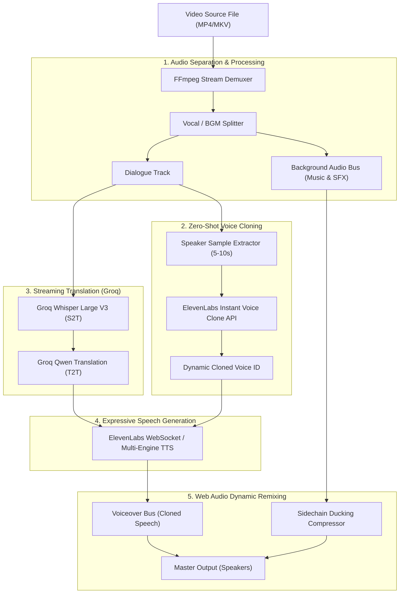
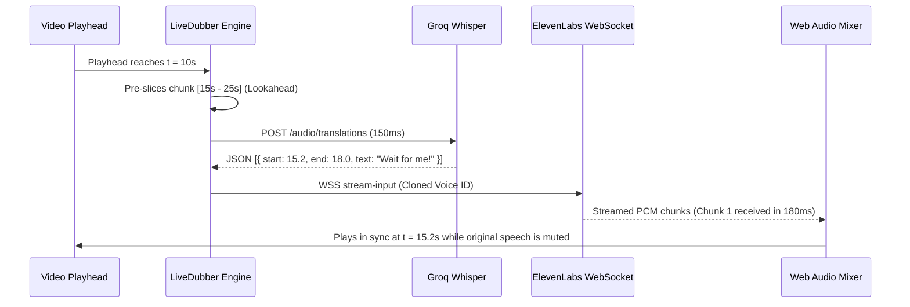

# Meta-Grade AI Dubbing & Voice Cloning Specification
## Real-Time Audio Stem Separation, Instant Voice Cloning, and Streaming S2ST

---

## 1. Executive Summary

This specification outlines the architecture to bring **Meta Reels-style AI dubbing** to **MAXVIDEO_PLAYER**. 

In conventional video translation, the entire audio track is muted, replacing human speech with a generic synthetic voice over dead silence. In contrast, Meta’s approach on Instagram Reels and Facebook preserves the original video's **emotional timbre, background music (BGM), sound effects (SFX), and voice personality**:

1. **Background Audio Preservation**: Separates vocals from music and ambient sound effects so explosions, laughter, and film scores remain intact.
2. **Instant Voice Cloning (Zero-Shot)**: Clones the actor’s unique vocal timbre, pitch, and cadence from a small sample so the translated speech sounds like the original person speaking the target language.
3. **Streaming Speech-to-Speech (S2ST)**: Employs sub-second streaming from audio capture to Whisper transcription and WebSocket-based TTS streaming.
4. **Sidechain Ducking**: Automatically dips the background score when dialogue is being spoken and smoothly restores it during pauses.

---

## 2. High-Level Architecture



---

## 3. Core Technical Pillars

### Pillar 1: Background Music & SFX Preservation (Stem Separation)

To prevent the video from sounding hollow, the original soundtrack must be separated into **dialogue** and **accompaniment**:

#### Approach A: Native Center-Channel Vocal Attenuation (Ultra-Fast / Local)
- Most film and video mixes place speech dead-center (mono) while background scores and ambient stereo field are panned wide.
- **FFmpeg Filter Implementation**:
  ```bash
  # Extracts stereo accompaniment by subtracting common center vocals
  ffmpeg -i input.mp4 -af "stereotools=mlev=0.1:slev=1.0:sbal=0,highpass=f=80,lowpass=f=14000" -vn bgm.mp3
  ```
- **Advantages**: Executes locally in < 50ms, zero cloud GPU cost, runs on CPU.

#### Approach B: Neural Stem Separation via ONNX (Demucs / Open-Unmix)
- Uses an embedded ONNX runtime model (`htdemucs_embedded.onnx`) running in an Electron background worker.
- Generates two discrete WAV streams:
  1. `vocals.wav` (fed into Whisper & Voice Cloning)
  2. `no_vocals.wav` (fed into Web Audio BGM Bus)

---

### Pillar 2: Instant Voice Cloning (Zero-Shot Speaker Profiling)

Instead of hardcoded default voices (e.g. Rachel, Adam), the player extracts the speaker's vocal fingerprint from the video.

#### 1. Audio Sample Extraction
- The first 6–10 seconds with high vocal energy (detected by Whisper confidence / VAD) are extracted via FFmpeg:
  ```javascript
  const sample = await window.mvp.extractAudioChunk({
    videoPath,
    startTime: bestVocalSegment.start,
    duration: 8
  });
  ```

#### 2. ElevenLabs Instant Voice Clone API (`/v1/voices/add`)
```javascript
POST https://api.elevenlabs.io/v1/voices/add
Headers:
  xi-api-key: <ELEVENLABS_API_KEY>
  Content-Type: multipart/form-data

FormData:
  name: "AutoClone-${videoName}-${speakerIndex}"
  files: [sampleBlob]
  description: "Dynamic auto-clone for real-time actor dubbing"
  labels: '{"accent": "original", "source": "maxvideoplayer"}'
```
- **Response**: Returns `voice_id` (e.g., `21m00Tcm4TlvDq8ikWAM`).
- The player saves `voice_id` to memory for the current session and sets it as the active voice for all future dialogue chunks in this video.

---

### Pillar 3: Streaming Speech-to-Speech Translation Pipeline

To reduce translation latency to **under 400ms**:



#### Low-Latency WebSocket Protocol (ElevenLabs)
- Endpoint: `wss://api.elevenlabs.io/v1/text-to-speech/{voice_id}/stream-input?model_id=eleven_multilingual_v2`
- Sends text chunks as soon as tokens arrive from Groq.
- Audio chunks stream directly into Web Audio buffers before the sentence finishes generating.

---

### Pillar 4: Dynamic Re-mixing & Sidechain Ducking

In a Web Audio `AudioContext`, we establish a dual-bus mixing topology:

```
[ <video> Element Audio ] ──► [ Splitter ]
                                  │
         ┌────────────────────────┴────────────────────────┐
         ▼                                                 ▼
[ Vocal Band Filter (300Hz-3kHz) ]           [ Sidechain Ducking Gain ]
         │ (Suppressed / Muted)                            ▲
         ▼                                                 │
      [ Mute ]                               [ Voice Envelope Follower ]
                                                           │
[ ElevenLabs Cloned Voice ] ───────────────────────────────┘
         │
         ▼
[ Master Destination (Output) ]
```

1. **BGM Bus**: The video's original background audio plays through a `GainNode`.
2. **Sidechain Envelope Follower**:
   - When the cloned TTS voice begins speaking, the BGM gain smoothly drops to **15% (ducking)** over a 50ms ramp.
   - When the TTS voice pauses or finishes, the BGM gain ramps back up to **100%** over 200ms.
3. **Result**: Seamless cinema-style dialogue mix where sound effects remain punchy during pauses.

---

## 4. Proposed File Structure & Modules

```
electron/src/services/
├── liveDubber.js         # Chunking scheduler & lookahead coordinator
├── voiceCloner.js        # [NEW] Audio sampling & ElevenLabs Instant Voice Cloning
├── stemSeparator.js      # [NEW] FFmpeg center-cut & ambient soundtrack isolator
├── audioMixer.js         # [NEW] Web Audio dual-bus graph with sidechain ducking
├── translator.js         # Groq Whisper and LLM translation client
├── ttsPrefetcher.js      # Lookahead TTS synthesizer & in-memory audio cache
└── syncEngine.js         # Web Audio clock synchronizer & drift corrector
```

---

## 5. Implementation Phases

| Phase | Milestone | Deliverables |
|---|---|---|
| **Phase 1** | **Audio Stem & BGM Extraction** | Implement [`stemSeparator.js`](file:///Users/pravs/Documents/code/maxvideoplayer/electron/src/services/stemSeparator.js) to isolate background music/SFX while filtering out vocals. |
| **Phase 2** | **Instant Voice Cloning** | Implement [`voiceCloner.js`](file:///Users/pravs/Documents/code/maxvideoplayer/electron/src/services/voiceCloner.js) with ElevenLabs `/v1/voices/add` to clone actor voices from the first detected speech. |
| **Phase 3** | **Dual-Bus Audio Mixer** | Implement [`audioMixer.js`](file:///Users/pravs/Documents/code/maxvideoplayer/electron/src/services/audioMixer.js) with Web Audio `DynamicsCompressorNode` for real-time speech ducking. |
| **Phase 4** | **Sub-500ms WebSocket Streaming** | Upgrade TTS synthesis from HTTP polling to bidirectional WebSocket streaming for near-instant playback. |

---

## 6. UI / UX Design Additions

1. **Voice Persona Badge**: Displays whether the active voice is an `Auto-Cloned Voice` (with the actor's timbre) or a preset voice.
2. **Audio Mixer Drawer**:
   - **Voiceover Level**: `0% - 100%`
   - **Background Ambience**: `0% - 100%`
   - **Ducking Sensitivity**: `Gentle / Cinema / Aggressive`
3. **Telemetry HUD Extension**:
   - Cloned Voice ID and confidence score.
   - Sidechain ducking activity meter (visualizing music dip in dB).
